# Lumina 全量工作流

> 生成时间：2026-10-23 · 基于当前仓库代码与实际运行结果
> 适用范围：本地单用户模式（Next.js 16 + SQLite）。图中「文件:函数」是代码落点，便于对照阅读。
> 约定：红色节点表示**当前实现与产品承诺不一致或已被实测证实有缺陷**的环节；黄色节点表示重要但有边界条件的环节。
> **2026-10-23 双模式改造**：第 9、20、21 节里关于「计划步骤至少 3 个知识点独立答对才完成」的旧规则已被第 22 节取代。当前模型是「计划 → 课程（plan_items）→ 知识点（concepts.course_id）」，并且分为无限学习与目标学习两种模式。

## 目录

1. [系统总览与模块地图](#1-系统总览与模块地图)
2. [核心数据模型](#2-核心数据模型)
3. [一次教学对话的完整链路](#3-一次教学对话的完整链路)
4. [教学工具执行流程](#4-教学工具执行流程)
5. [练习生命周期](#5-练习生命周期)
6. [判题、证据与 BKT 更新](#6-判题证据与-bkt-更新)
7. [掌握度状态机](#7-掌握度状态机)
8. [复习队列与今日计划](#8-复习队列与今日计划)
9. [计划（目标）工作流](#9-计划目标工作流)
10. [学习材料工作流](#10-学习材料工作流)
11. [联网检索工作流](#11-联网检索工作流)
12. [引用协议工作流](#12-引用协议工作流)
13. [多模型配置与会话模型选择](#13-多模型配置与会话模型选择)
14. [会话删除、证据作废与重算](#14-会话删除证据作废与重算)
15. [工作区工作流](#15-工作区工作流)
16. [前端导航与板块联动](#16-前端导航与板块联动)
17. [启动、构建与测试](#17-启动构建与测试)
18. [鉴权与安全边界](#18-鉴权与安全边界)
19. [代码落点索引](#19-代码落点索引)
20. [教完 / 答完后的下一步操作](#20-教完--答完后的下一步操作2026-10-23-新增)
21. [多题小测（第一版）](#21-多题小测第一版)
22. [双模式与计划 → 课程 → 知识点（2026-10-23 重构）](#22-双模式与计划--课程--知识点2026-10-23-重构)

---

## 1. 系统总览与模块地图

Lumina 是「对话驱动 + 结构化教学组件 + 长期学习证据」的本地应用。浏览器只负责展示与交互；模型不能直接渲染组件，只能调用 9 个白名单工具；答案、评分规则、掌握度全部留在服务端 SQLite。

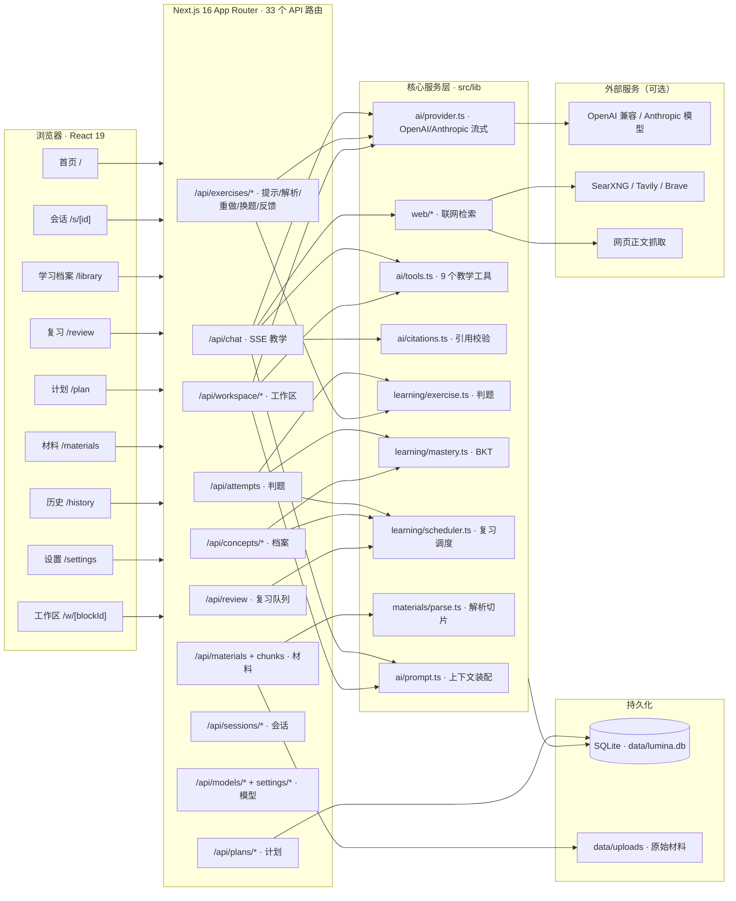

**模块职责**

| 层 | 关键文件 | 职责 |
| --- | --- | --- |
| 会话 UI | `src/components/chat/SessionView.tsx` | SSE 消费、消息/组件渲染、模型切换、会话删除 |
| 教学编排 | `src/app/api/chat/route.ts` | 落库消息、装配上下文、流式调用、执行工具、引用校验 |
| 提示词 | `src/lib/ai/prompt.ts` | 系统提示词、学习者上下文、历史、材料/网络来源注入 |
| 工具 | `src/lib/ai/tools.ts` | zod 校验 + 唯一结构化内容入口 |
| 判题 | `src/lib/learning/exercise.ts` | 8 题型确定性判题、开放题交给模型 |
| 掌握度 | `src/lib/learning/mastery.ts` | BKT + 状态推导 + 证据权重 |
| 调度 | `src/lib/learning/scheduler.ts` | FSRS 启发式间隔 |
| 数据 | `src/lib/db/repo.ts` | 全部 SQL、聚合重算、审计 |
| 材料 | `src/lib/materials/parse.ts` | txt/md/pdf/docx/html 解析与切片 |
| 联网 | `src/lib/web/*` | 门控、provider、SSRF 防护、评分、缓存 |

---

## 2. 核心数据模型

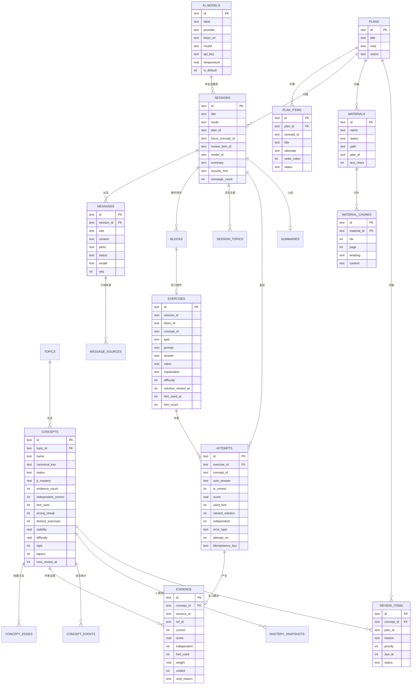

**设计原则（代码中真实执行）**

1. `blocks.state` 只存 UI 状态（草稿、滑块参数），不写学习证据。
2. `evidence` 与 `attempts` 是长期档案；删除会话默认保留。
3. 掌握度永远由证据推导，不直接采用模型自评；人工更正写 `concept_events`。
4. 答案与评分规则只在 `exercises.answer`，公开 DTO 不包含答案。

**未被使用的模型资产（现状）**：`users`、`goals`（含 `sessions.goal_id` / `plans.goal_id`）、`source_feedback` 的读取侧、`usage_log` 的展示侧、`concept_edges` 的产品使用、`plan_items.concept_id`。详见验收报告「死代码」章节。

---

## 3. 一次教学对话的完整链路

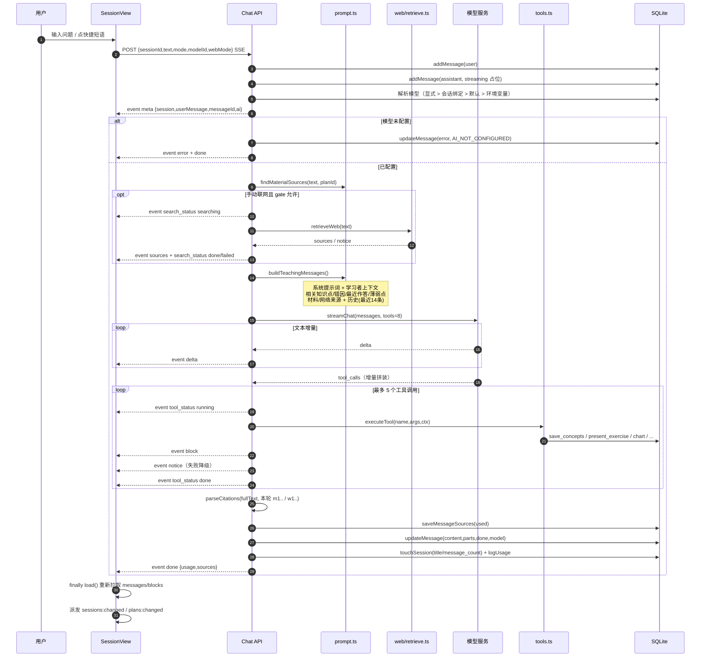

**边界与失败处理（已实现）**

- 模型未配置：不生成教学内容，只给配置指引。
- 超时/限流/鉴权失败/输出格式错误/客户端中断：保留已生成文本，标注错误并写 `usage_log`。
- 模型编造 `[[m9]]`：服务端剥离并提示，不产生死链。
- 有来源但正文没标注：追加「本次回答未标注来源」提示。
- 达到输出上限：保留内容并提示「可能没讲完」。
- 工具参数校验失败：不落组件，发 notice 降级。

**现状问题（已实测/代码确认）**

- 工具执行只有**一轮**：模型看不到工具执行结果，不能在同一回合内根据失败结果修正。
- 工具 JSON 解析失败会抛异常，导致整条回答走错误分支（zod 失败不会）。
- 真实模型抽样中出现**只调用工具、正文为空**的回合（C 场景），UI 只显示题目、没有一句过渡解释。
- 历史上下文只保留文本和 `[已展示练习]` 占位，不保留图表/表格/练习的具体数据；多轮后模型可能不记得组件内容。

---

## 4. 教学工具执行流程

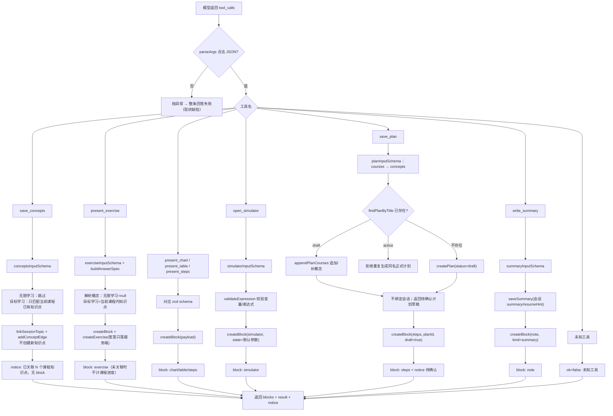

**关键约束**

- 工具是模型输出「可交互教学内容」的唯一方式；模型不直接写 React。
- `present_exercise` 的 `answer` 只写服务端；`present_*` 失败时不伪造组件。
- 一个回合最多执行 5 个工具（提示词要求不超过 3 个）。
- `write_summary` 的 progress 没有服务端证据校验，属于「模型自述」；UI 却把它显示为「有证据的进展」（现状不一致）。

---

## 5. 练习生命周期

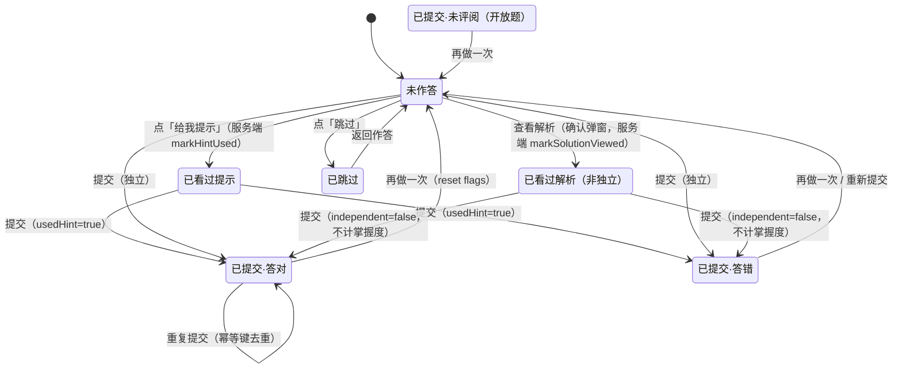

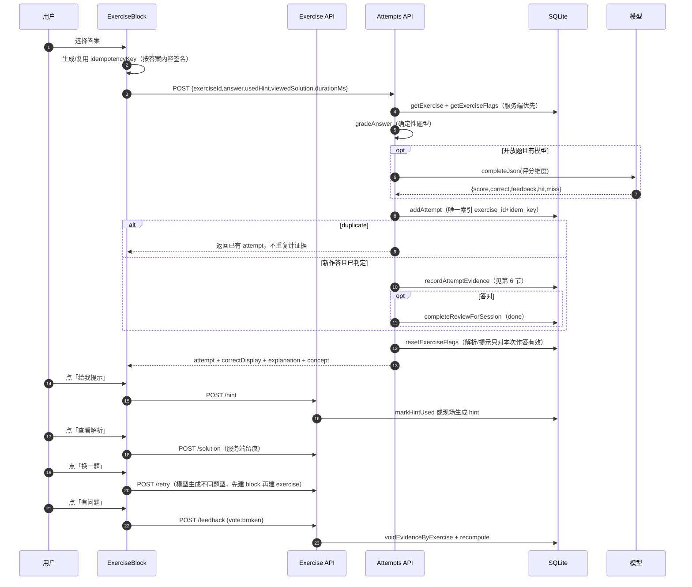

**现状缺陷（实测）**

1. **「再做一次」不重置 `usedHint` / `hint` 文案**：提示仍然显示，下一次提交继续带 `usedHint=true`，独立正确数不增加。
2. **「再做一次」不重置幂等键**：同一答案在同一页面再次提交会复用旧 key，服务端判定 `duplicate=true`，不产生新证据。
3. **查看解析后作答仍推进复习调度**：`applyEvidence` 不增加证据，但 `recordAttemptEvidence` 仍执行 `scheduleNext` 并删除 open 复习条目。
4. **「跳过」只是前端状态**：刷新后题目重新出现，未做题不记任何记录。
5. **「有问题」后题目仍可继续作答**：旧证据作废，但新提交又会生成新证据；没有禁用或标记坏题。
6. 判题反馈是模板化的；单选/判断的错因几乎总是「概念混淆」，可能误导后续教学。

---

## 6. 判题、证据与 BKT 更新

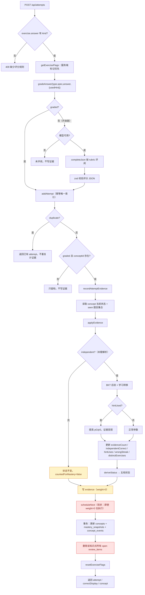

**判题规则的现状**

| 题型 | 判定方式 | 风险 |
| --- | --- | --- |
| 单选 | 下标完全相等 | 错选反馈模板化，错因几乎总是概念混淆 |
| 多选 | 集合完全相等 | 不给部分分；漏选/多选有具体提示 |
| 填空 | 归一化后相等，或**任一方向包含**（候选长度≥3） | **实测「成本」会被判对「机会成本」**，假阳性 |
| 判断 | true/false 归一化 | 错误文案假设固定原因 |
| 排序 | 完整顺序 + 第一个错位提示 | 反馈假设「上一步产出=下一步输入」 |
| 计算 | 绝对误差 ≤ tolerance | 默认 1%，对某些学科过严 |
| 分步骤 | 每步按填空规则 | 同填空，子串假阳性 |
| 开放 | 模型按 rubric 评阅；失败不计 | 评分一致性依赖模型，无校准 |

**BKT 参数**

- `pL0=0.1`、`pS=0.1`、`pT≈0.22`（随难度微调）。
- `pG` 按题型：判断 0.5、单选 0.25、多选 0.12、填空/分步 0.08、计算 0.06、其他 0.05。
- 使用提示：`pG+0.18`、`pS+0.05`，证据变弱。
- 查看解析：`independent=false`，不进入 BKT（但仍写 weight=0 证据）。

**已实现的可信度保障**

- 答案不在公开 DTO 中；提交后才返回 `correctDisplay`。
- 幂等唯一索引 + 服务端提示/解析留痕。
- 删除证据/会话后按剩余证据重放 BKT 与调度（`recomputeConceptAggregates`）。
- 每次状态变化写 `concept_events`，每次更新写 `mastery_snapshots`。

---

## 7. 掌握度状态机

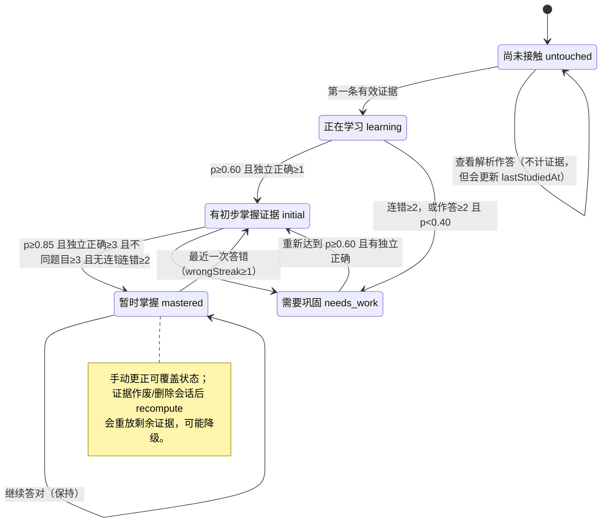

**时间衰减**：`stalenessDays()` 已实现但**未被调用**；长期不复习不会自动降级 p 值，只会通过 `next_review_at` 进入复习队列。

---

## 8. 复习队列与今日计划

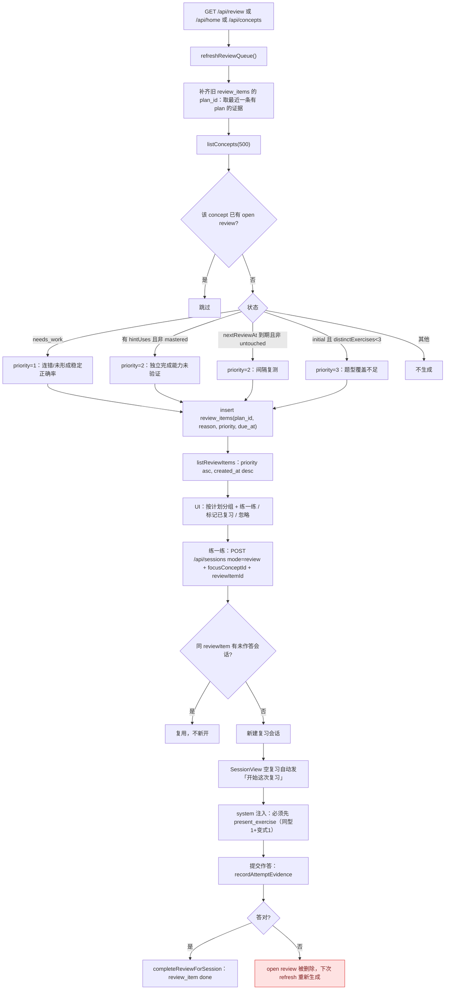

**今日计划优先级**（`/api/home`）

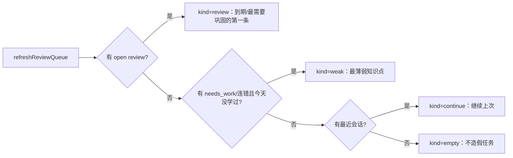

**实测缺陷**

- **「忽略」和「标记已复习」不会持续生效**：`actOnReviewItem` 只改当前条状态，下一次 `refreshReviewQueue` 仍会为该 concept 新建一条（实测：dismissed 后立即以新 id 重新出现）。
- **任何作答都会删除 open 复习条**，包括「查看解析后作答」这种不计证据的作答；随后下一次刷新又重建，造成条目 id 抖动。
- 复习条目完成与否和会话不再绑定：答错后旧会话仍有题目，但 review item 已被删除；下次「练一练」可能新开会话。
- `findOpenReviewSession` 只复用「没有任何 attempts」的复习会话；答错一次后再点就会新开。

---

## 9. 计划（目标）工作流（旧版，当前口径见第 22 节）

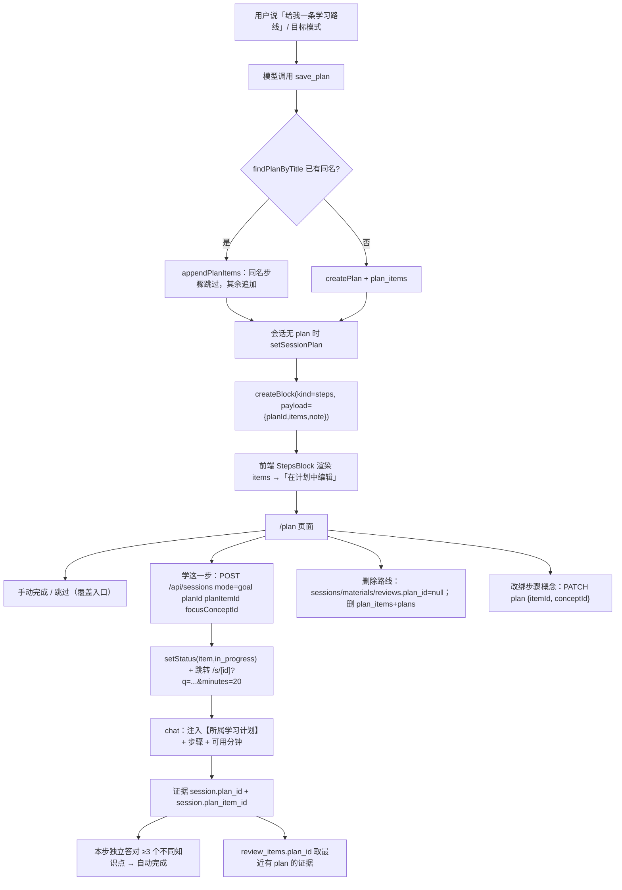

**现状说明**

- `save_plan` 只绑定档案里**已经存在**的知识点；不会为未来课程预建空壳概念。未命中的步骤显示「未绑定概念」，可在计划页「改绑」。
- 「学这一步」会带 `planItemId` 和 `focusConceptId`；会话与步骤双向绑定。
- 步骤完成由证据判定：本步至少 3 个不同知识点独立答对（未看解析/未用提示/未作废）→ 自动完成；未达标只显示「继续检验（x/3）」。
- 计划页的「手动完成」只是覆盖入口；不是主流程。
- 还不能编辑步骤标题、顺序或手动增删步骤；计划进度 `done/total` 不排除 skipped。

---

## 10. 学习材料工作流

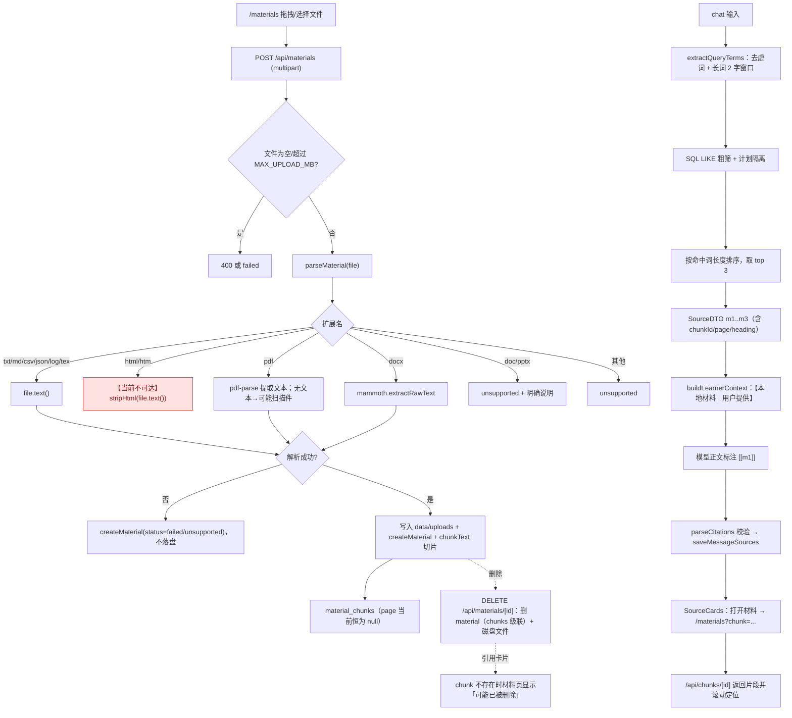

**现状问题**

- `CODE_EXT` 已包含 `.html`，所以 `.html` 永远走 `file.text()` 原始分支，`stripHtml` 不可达；HTML 脚本/标签会原样进入检索和提示词。
- 材料块没有「这段是数据、不是指令」的防注入声明（网络来源有）；恶意材料可尝试提示词注入。
- `page` 在所有解析路径均为 `null`，因此 UI 的「第 x 页」与 README 的「页码」承诺实际不会出现。
- 解析失败的材料仍会创建一条 DB 记录（磁盘不落盘），UI 列表会保留失败项；这是可接受的设计，但需明确。
- 检索是关键词/LIKE，不是向量；长材料只有前 400 个切片，超出会静默截断。
- 计划隔离是严格的：有计划会话只检索同计划材料，未归类只用未归类材料。

---

## 11. 联网检索工作流

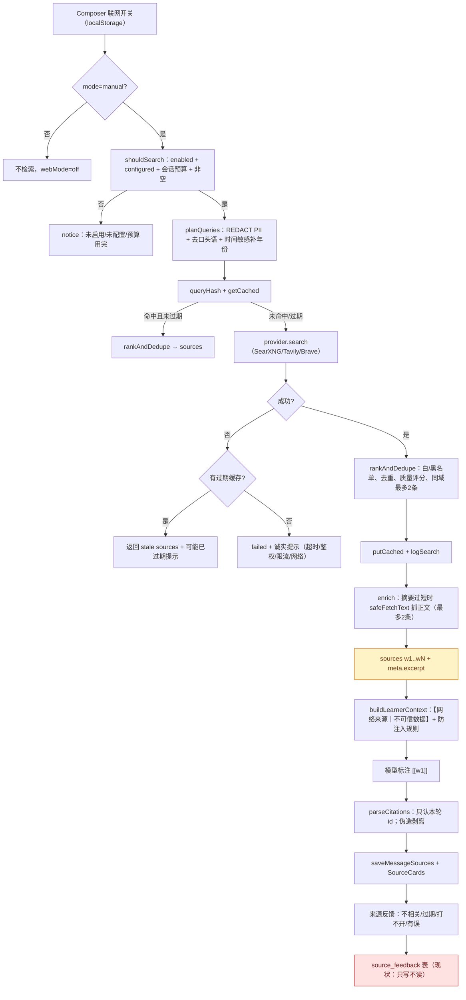

**现状问题**

- `retrieveWeb` 只使用 `queries[0]`，`planQueries` 生成的第二个查询（site: 白名单）实际上从未被使用。
- `enrich` 抓到的正文写进 `sources[i].meta.excerpt`，但提示词只读 `w.snippet`，正文没有进入 prompt。
- 来源反馈写入 `source_feedback` 后，评分/排序没有任何读取逻辑；UI 的「后续会降低同类来源权重」未兑现。
- 联网只支持手动模式；没有自动意图识别（文档已说明）。
- SSRF 防护较完整（DNS 校验、重定向逐跳、2MB 上限），但 DNS 解析与 fetch 之间存在 rebinding 窗口；本地场景可接受。

---

## 12. 引用协议工作流

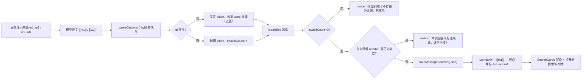

**现状问题**：工作区（`/api/workspace`）没有走 `parseCitations` / `saveMessageSources`，若模型在工作区输出引用，角标可能指向不存在的来源卡片。导出功能 `renderCitationsForExport` 只有单元测试，没有产品入口。

---

## 13. 多模型配置与会话模型选择

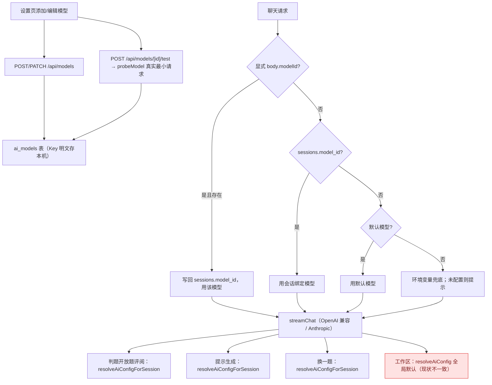

**现状问题**

- 工作区不受会话模型选择影响，也不写 `messages.model` / `usage_log`。
- `/api/settings/ai` 仍保留旧版单模型 PUT；UI 已不用，但接口仍可写默认模型。
- 模型 Key 明文存在 SQLite（本地单用户可接受；多用户/公网部署前必须改）。
- 部分兼容端点可能不支持 `stream_options.include_usage`；当前没有降级开关。

---

## 14. 会话删除、证据作废与重算

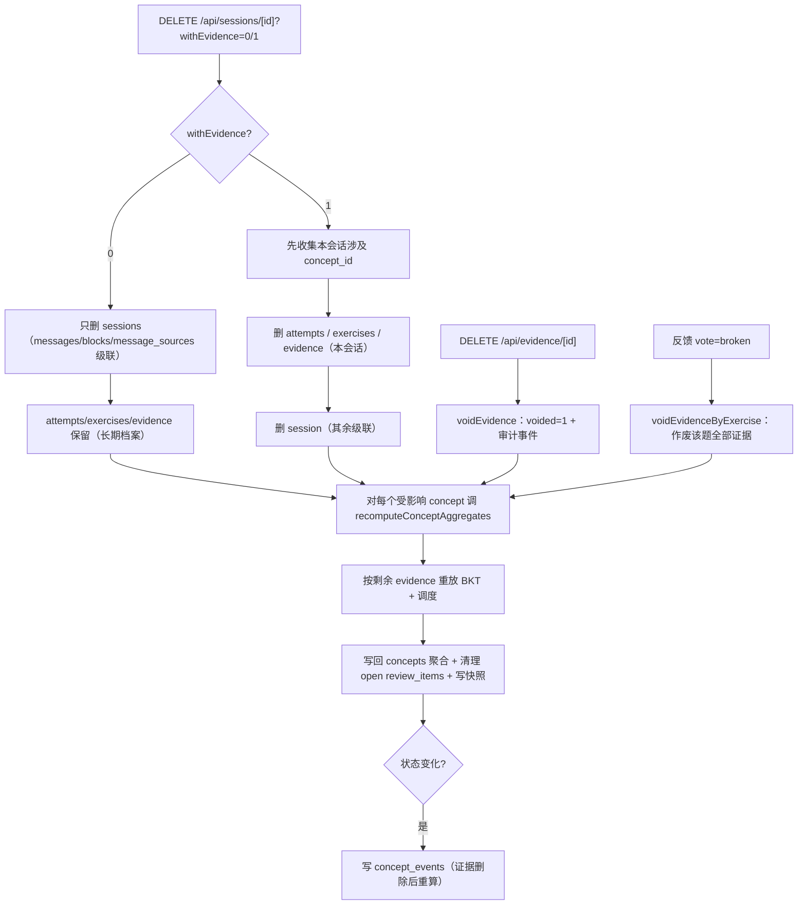

**删除语义**

- 删会话默认保留题目、作答与证据；勾选后可连带删除本会话产生的证据并重算。
- 删知识点会删除其证据/快照/事件/复习项，但保留会话里的题目与作答（`concept_id` 置空）。
- 删计划不会删知识点/证据，只把 sessions/materials/review_items 的 `plan_id` 置空。
- 删材料会删切片与磁盘文件；已有回答里的来源卡片仍保留标题/摘要，点回原文会提示片段不存在。

**遗留问题**

- `deleteSession(withEvidence)` 删除 attempts/exercises/evidence 时不会清理 `exercise_feedback`，会留下孤儿记录。
- 删除会话后，旧 `exercises.block_id` 可能指向已删 block（无 FK），但题目本身保留，不影响档案。

---

## 15. 工作区工作流

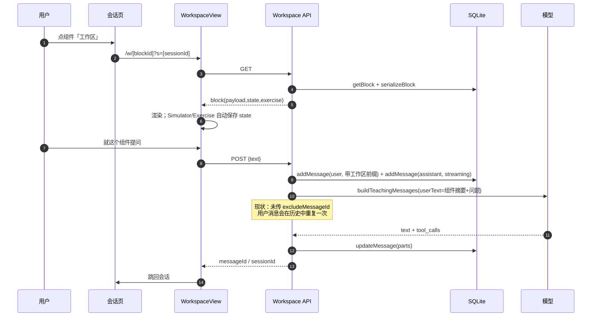

**现状问题**：默认模型、历史重复、无引用校验、无 usage_log、无流式；工作区只是「组件 + 一次性问答」，不是一个完整的并行学习面板。

---

## 16. 前端导航与板块联动

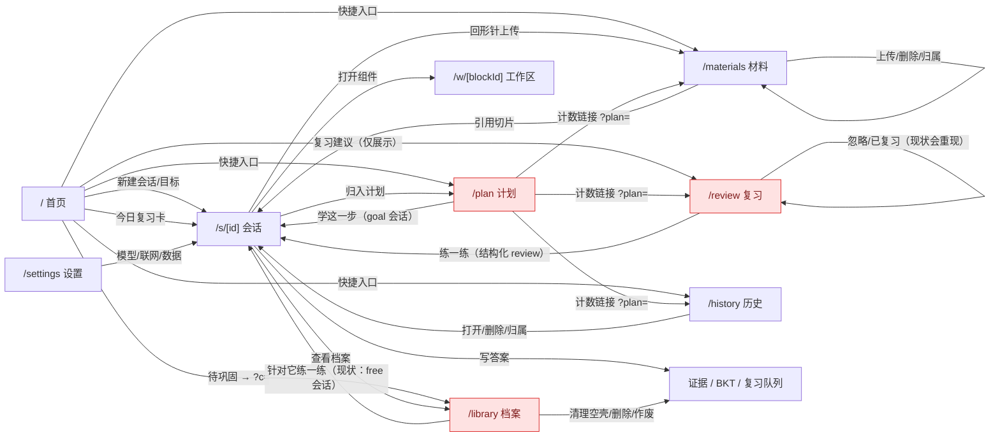

**联动实测结论**

| 链路 | 状态 | 说明 |
| --- | --- | --- |
| 首页 → 今日复习 → 结构化复习 → 完成 | ✅ | 传 focusConceptId/reviewItemId，答对自动收尾 |
| 复习页 → 练一练 → 复用未作答会话 | ✅ | `findOpenReviewSession` 只在无 attempts 时复用 |
| 计划页计数 → 历史/材料/复习筛选 | ✅ | `?plan=` 各页独立预选 |
| 计划 → 学这一步 → 目标会话 | ⚠️ | 有 planId，但无 focusConceptId/planItemId；步骤不会自动完成 |
| 材料上传 → 同计划会话引用 → 来源跳回 | ✅ | 计划隔离、引用校验、切片定位都可用 |
| 档案 → 针对它练一练 | ❌ | 新建 free 会话，丢计划与结构化复习 |
| 复习 → 忽略/标记已复习 | ❌ | 刷新后立即重新出现 |
| 工作区 → 提问 → 回会话 | ⚠️ | 能用，但默认模型、消息重复、无来源校验 |
| 首页复习建议卡片 | ⚠️ | 只展示，不能直接开始 |
| 删除计划 → 关联项回未归类 | ✅ | sessions/materials/review_items 都置空 |
| 删除会话（默认）→ 证据保留 | ✅ | 实测通过 |
| 删除会话（连带证据）→ 聚合重算 | ✅ | 实测通过，p/状态按剩余证据重放 |

---

## 17. 启动、构建与测试

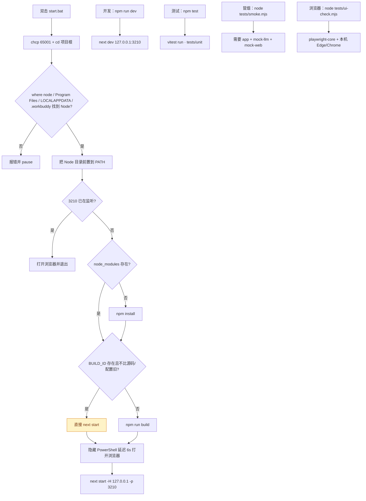

**启动器现状**：`start.bat` 已通过 `scripts/needs-build.mjs` 比较 `src` + 配置文件的 mtime 与 `.next/BUILD_ID`；源码变了会自动重建，不再悄悄跑旧构建。

**测试现状**

- 单元/集成：103/103（判题、BKT、调度、检索、repo 事务、聚合重算、合并、计划绑定、清理保护）
- 冒烟：72/72（本轮早期实测；真实 HTTP + 测试替身模型）
- 浏览器：回归全绿（48 项执行；空壳清理分支因已无空壳跳过）
- 构建：Turbopack 与 Webpack 构建均通过；3210 已重启
- 真实模型：5 次调用全部成功；质量抽样见验收报告。

---

## 18. 鉴权与安全边界

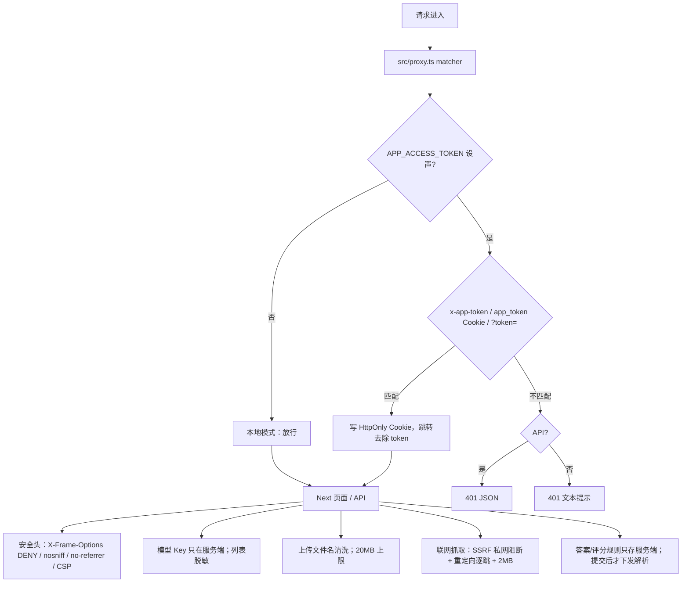

**边界**

- 默认只监听 `127.0.0.1`；`start:lan` 显式放开。公网部署必须设置 `APP_ACCESS_TOKEN`。
- 单用户本地模式无 CSRF token/限流；局域网或公网部署前需要补。
- `handleError` 会把内部错误信息拼到响应（P3）；公网前应改为通用文案 + 服务端日志。
- Key 明文存 SQLite；本地可接受，多用户/云部署不可接受。
- CSP 允许 `'unsafe-inline'`（Next 启动脚本需要）；未使用 nonce。
- 材料默认被当作可信上下文，没有「数据不是指令」声明；网络来源有。建议补齐。

---

## 19. 代码落点索引

| 工作流 | 主要落点 |
| --- | --- |
| 教学对话 | `src/app/api/chat/route.ts` · `src/lib/ai/prompt.ts` · `src/lib/ai/provider.ts` |
| 教学工具 | `src/lib/ai/tools.ts` · `src/lib/blocks/schema.ts` |
| 判题 | `src/lib/learning/exercise.ts` · `src/app/api/attempts/route.ts` |
| 证据/BKT | `src/lib/learning/mastery.ts` · `src/lib/db/repo.ts:recordAttemptEvidence/recomputeConceptAggregates` |
| 调度 | `src/lib/learning/scheduler.ts` · `src/lib/db/repo.ts:refreshReviewQueue` |
| 复习 | `src/app/review/page.tsx` · `src/app/api/review/route.ts` |
| 今日计划 | `src/app/api/home/route.ts` · `src/app/page.tsx` |
| 计划 | `src/app/plan/page.tsx` · `src/app/api/plans/*` · `src/lib/ai/tools.ts:save_plan` |
| 材料 | `src/lib/materials/parse.ts` · `src/app/api/materials/*` · `src/lib/db/repo.ts:searchMaterialChunks` |
| 联网 | `src/lib/web/*` · `src/app/api/settings/web/*` |
| 引用 | `src/lib/ai/citations.ts` · `src/components/Markdown.tsx` · `src/components/chat/SourceCards.tsx` |
| 多模型 | `src/app/api/models/*` · `src/lib/ai/config.ts` · `src/components/chat/Composer.tsx` |
| 会话 | `src/app/api/sessions/*` · `src/lib/db/repo.ts:createSession/deleteSession` |
| 工作区 | `src/app/api/workspace/[blockId]/route.ts` · `src/components/workspace/WorkspaceView.tsx` |
| 前端联动 | `src/app/*/page.tsx` · `src/components/layout/AppShell.tsx` · `src/components/PlanSelect.tsx` |
| 启动/安全 | `start.bat` · `src/proxy.ts` · `next.config.ts` |

---

## 20. 教完 / 答完后的下一步操作（2026-10-23 新增）

> 对应用户反馈：「教学流程都是我推动的，教完知识点、答完题后应该有选项，不用一直说然后呢」。
> 说明：第 9 节里「计划步骤不绑定知识点」的旧描述已过时；当前计划步骤支持 `conceptId`，会话也通过 `plan_item_id` 绑定到具体步骤。

```mermaid
flowchart TD
  A["最后一条助手消息"] --> B{"这条消息里有练习组件?"}
  B -- 否 --> C{"是计划路线块?"}
  C -- 是 --> C1["下一步：开始第一步 / 继续当前步骤"]
  C -- 否 --> C2["下一步：出题检验 / 换个讲法 / 继续检验（x/3）"]
  B -- 是 --> D{"题目已判定且答对?"}
  D -- 是 --> D1["下一步：继续检验（x/3）或进入 Day Y / 讲讲这道题 / 看知识点"]
  D -- 否（答错或未评阅） --> D2["只给：讲讲这道题 / 看知识点<br/>不提供离开本步，先讨论或重做"]

  C1 --> E["PATCH 会话 plan_item_id + 步骤 in_progress"]
  C2 --> E2["发送“出题检验/换个讲法/针对未验证知识点出题”等提示词"]
  D1 --> F{"本步独立答对的不同知识点 ≥ 3?"}
  F -- 否 --> F1["继续检验：只出题，不完成步骤"]
  F -- 是 --> F2["自动标记步骤 done<br/>按钮变为“进入 Day Y”<br/>创建下一步 goal 会话并自动开始"]
  E2 --> G["AI 继续同一会话"]
```

**行为约定**

- **完成不再由用户判断**：本步至少有 3 个不同知识点独立答对（未看解析、未用提示、未作废）时，服务端自动把计划步骤标为完成；同一个知识点重复答对只算 1 个。
- 未达标时，按钮显示 `继续检验（x/3）`；点击只会让 AI 针对还没验证的核心知识点出题，不会把步骤标完成。
- 达到 3/3 后，按钮变为「进入 Day Y」；点击会创建下一步目标会话（自动带 plan、planItemId、focusConceptId、20 分钟预算）。
- 答完题：只有**判定正确**才出现「继续检验 / 进入 Day Y」；答错或未评阅只给「讲讲这道题 / 看知识点」，避免没掌握时跳过。
- 计划页显示每一步的 `验证 x/3` 和已验证知识点名称；页面上的「手动完成」只是覆盖入口，不是主流程。
- 会话与计划步骤双向绑定：`sessions.plan_item_id` 记录本会话属于哪一步；回看旧会话时不会误完成后面的步骤。
- 计划页「学这一步」也会带 `planItemId`，新建步骤会话从一开始就是绑定状态。

**当前数据状态**：示例计划 Day 1 已改绑到「中心化记账」，实际证据 1/3；未来 6 步未绑定概念，可在计划页「改绑」。历史重复概念已合并，计划空壳已清理，旧消息里的 `[已展示table]` 已清理。

**回归**：106 个单测/集成、浏览器回归 55/55（含多知识点混合小测）、专项交互/证据完成/合并改绑/混合小测推进计划探针通过；默认构建与 Webpack 构建均通过。

---

## 21. 多题小测（第一版）

```mermaid
flowchart TD
  A["模型调用 present_quiz"] --> B["quizInputSchema：2–5 道题<br/>默认 concept/topic，每题可覆盖"]
  B --> C["逐题 exerciseInputSchema + buildAnswerSpec"]
  C --> D["并发出题二次校验 verifyExercise"]
  D -- 任一道 failed --> D1["整套不生成 + notice"]
  D -- passed / ambiguous / unverified --> E["createBlock(kind=quiz)"]
  E --> F["createExercise × N<br/>共享 blockId，各自 conceptId"]
  F --> G["serializeBlock → quizExercises<br/>公开 DTO 不含答案"]
  G --> H["QuizBlock：第 n 题 / 共 N 题"]
  H --> I["统一提交 → POST /api/quizzes/[blockId]/attempts"]
  I --> J["逐题判分 + addAttempt<br/>仅 verification=passed 写 evidence"]
  J --> K["syncPlanItemCompletion<br/>返回答对 x/n、平均分、逐题反馈"]
  K --> L{"全部答对且全部计入证据?"}
  L -- 是 --> M["继续下一步 / 讲讲这套题 / 看知识点"]
  L -- 否 --> N["讲讲这套题 / 看知识点 / 再做一次"]
```

**第一版范围**

- 支持 2–5 道确定性题（单选/多选/填空/判断/排序/计算/分步骤）；**不支持 open**（避免多题分别走 AI 评阅、拖慢一次提交）。
- 整套题可以有默认 `concept/topic`，每题可用自己的 `concept/topic` 覆盖；因此一套小测可混合多个知识点。逐题仍经过二次校验，`failed` 整套不生成，`ambiguous/unverified` 可作答但不计入掌握度。
- 统一提交：服务端逐题判分、按每题自己的知识点写 attempts/evidence、同步计划步骤，返回 `答对 x/n 题`、平均得分和逐题反馈。
- 提交幂等键按「整套答案签名」生成，再拼每题 exercise id；重复提交不重复计证据。
- UI 支持「再做一次」；只有全部答对且全部计入证据时才提供「继续下一步」，否则先讨论/重做。头部会显示「覆盖 N 个知识点」，每题显示自己的档案入口。
- **计划步骤完成**：混合小测如果覆盖了本步 3 个不同知识点并全部独立答对，会一次性把本步推进到 3/3 并自动完成；只覆盖一个知识点的 3 题小测会让该概念掌握度上升，但不会替整个多概念步骤「盖章」，计划按钮会继续提示「继续检验（x/3）」。
- 暂不支持：每题独立提示/查看解析、逐题分步提交、自定义插图。

**代码落点**：`src/lib/ai/tools.ts`（present_quiz）、`src/app/api/quizzes/[blockId]/attempts/route.ts`、`src/components/blocks/QuizBlock.tsx`、`src/components/blocks/AnswerInput.tsx`、`src/lib/api/serialize.ts`。

---

## 22. 双模式与计划 → 课程 → 知识点（2026-10-23 重构）

### 22.1 两种学习模式

```mermaid
flowchart TD
  H["首页：今天想怎么学？"] --> I["无限学习：直接输入想学的内容"]
  H --> G["目标学习：输入学习目标"]
  I --> I1["POST /api/sessions mode=infinite<br/>不要求计划 / 课程"]
  I1 --> I2["对话式教学：追问 / 换讲法 / 练习"]
  I2 --> I3["练习可判题，但 concept_id=null<br/>不写 evidence / 掌握度 / 复习"]
  I3 --> I4["历史中独立显示为「无限学习」"]
  I2 -. 用户明确要求整理 .-> I5["save_plan 生成计划草稿"]
  G --> G1["POST /api/sessions mode=goal（未绑定计划）"]
  G1 --> G2["AI 调用 save_plan：计划 → 课程 → 知识点"]
  G2 --> G3["plans.status=draft<br/>不绑定会话、不产生进度"]
  G3 --> G4["/plan/[id] 编辑课程 / 知识点 / 顺序"]
  G4 --> G5["用户确认：plans.status=active"]
  G5 --> G6["/plan/[id]/course/[courseId] 开始学习"]
  G6 --> G7["mode=goal + planId + planItemId<br/>concepts.course_id 唯一归属课程"]
  G7 --> G8["作答证据 → 课程/计划进度统一重算"]
```

### 22.2 目标学习：草稿必须先确认

- `save_plan` 只创建 `status='draft'` 的计划；同一标题的草稿再次生成会追加课程，不会重复建计划。同名正式计划存在时拒绝重复生成。
- AI 不会自动把规划会话绑定到计划，也不会在草稿阶段开始教学。
- 草稿页支持：修改计划名称/目标、增删课程、修改课程名称/说明、调整课程顺序、增删/改名知识点、暂停/恢复计划、跳过课程。
- 确认前 API 拒绝从该计划创建学习会话；确认要求至少一门课程且至少一个知识点。
- 知识点只能归属一门课程（`concepts.course_id`）。已属于其他课程的知识点不会被静默复制，计划草稿会提示冲突，用户可先在档案中合并/移除。

### 22.3 课程与计划进度

- 课程 = `plan_items`（一个学习单元），计划 = `plans`，知识点 = `concepts`。
- 知识点状态内部仍有 5 档，普通界面统一为：待学习 / 学习中 / 待复习 / 已掌握。
- 学习进度按知识点状态加权：已掌握 1、学习中 0.4、待复习 0.2、待学习 0；只有**课程内全部知识点已掌握**才算课程完成。
- 计划学习进度 = 所有未跳过课程的知识点加权汇总；`coursesDone/coursesTotal` 只统计真正完成的课程。
- 没有知识点的课程标为「未配置知识点」，不计入完成率；界面会单独提示。
- 首页、计划列表、计划详情、课程页、档案页使用同一套 `PlanDTO.progress / PlanItemDTO.progress`，没有各自计算。

### 22.4 无限学习的隔离规则

- 服务端按会话 `mode` 强制：`save_concepts` 不创建正式知识点；`present_exercise/present_quiz` 只创建练习，`concept_id=null`，不写证据、不推进课程/复习。
- 无限学习会话不展示课程完成率、计划步骤或正式进度；历史页单独归组。
- 只有用户明确要求整理时，才允许调用 `save_plan` 生成待确认草稿；普通提问、练习、聊天都不会自动建档。
- 旧版 free 会话迁移：没有计划的改为 infinite；明确绑定了计划的旧会话改为 goal，避免无限学习残留正式计划绑定。

### 22.5 数据迁移与兼容

- `sessions.mode`：`free → infinite`；有 `plan_id` 的旧 free 会话改为 `goal`。
- `concepts.course_id`：新增列 + 索引；旧 `plan_items.concept_id` 迁入课程归属。
- 旧步骤完成时可能验证过多个知识点，但只存了一个 `concept_id`；迁移会按「有明确会话步骤证据」把其余概念补回课程。无法确认归属的保持 `course_id=null`，档案显示「待整理」，不自动猜测。
- `plans.status`：旧计划补为 active；新草稿为 draft。旧测试/演示数据不需要保留时可直接重建数据库。
- 已保留：历史会话、消息、作答、证据、复习记录；删除计划/课程在 2026-10-24 后改为连同其名下知识点与证据一起删除（共享知识点只解除归属），会话与作答记录本身仍保留。

### 22.6 页面与 API 落点

- 首页：`src/app/page.tsx`（双模式入口、目标计划卡片、无限学习历史）。
- 计划列表/详情/课程：`src/app/plan/page.tsx`、`src/app/plan/[id]/page.tsx`、`src/app/plan/[id]/course/[courseId]/page.tsx`。
- 计划 API：`src/app/api/plans/route.ts`、`src/app/api/plans/[id]/route.ts`（confirm/pause/resume/update/addCourse/updateCourse/deleteCourse/moveCourse/skipCourse/addConcept/removeConcept/renameConcept）。
- 会话 API：`src/app/api/sessions/route.ts`、`src/app/api/sessions/[id]/route.ts`（模式校验、无限学习禁止自动挂计划）。
- 档案：`src/app/library/page.tsx`（按计划/课程分组，指标进详情）。
- 复习/历史：`src/app/review/page.tsx`、`src/app/history/page.tsx`（课程归属、无限学习独立分组）。
- 进度与状态：`src/lib/learning/progress.ts`；数据层：`src/lib/db/repo.ts`；模式提示词：`src/lib/ai/prompt.ts`；工具：`src/lib/ai/tools.ts`。

**验收**：单元/集成测试 112 项通过；API 冒烟 81 项通过；浏览器回归 69 项通过；生产构建通过；桌面与 390px 移动端页面无横向溢出。
